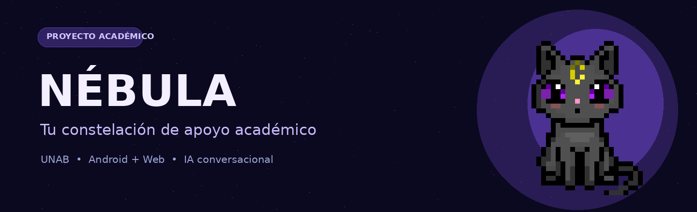
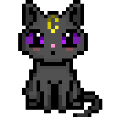
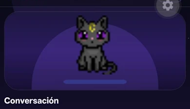
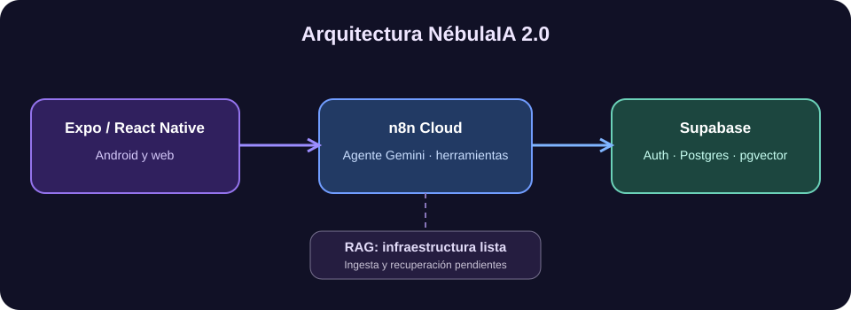
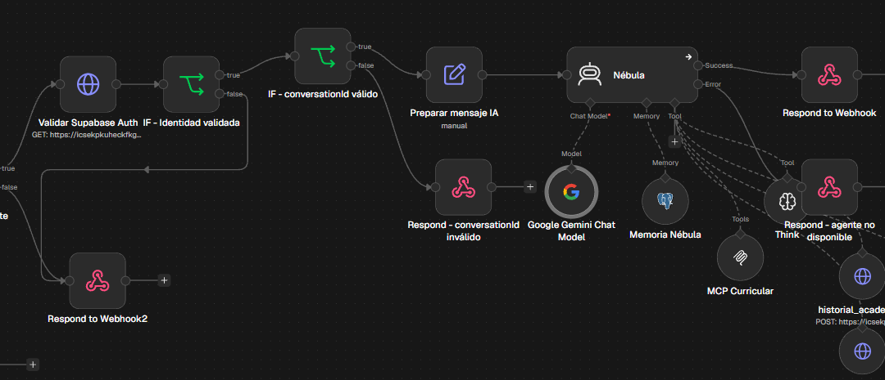

<div align="center">



# 🌌 NébulaIA 2.0

**Una constelación de respuestas para tu vida académica**

Asistente académico conversacional para estudiantes de **Ingeniería de Sistemas de la Universidad Autónoma de Bucaramanga (UNAB)**.

**Android · Web · React Native · Gemini · n8n Cloud · Supabase · PostgreSQL · pgvector**



</div>

## ✨ ¿Qué hace Nébula?

Nébula combina una interfaz galáctica con un gatito original animado y un chatbot conectado a servicios en la nube. Permite consultar información curricular, solicitar orientación académica y visualizar herramientas de seguimiento y planificación.

- 💬 **Chat con IA:** Gemini 3.5 Flash Lite, orquestado mediante n8n Cloud.
- 🔐 **Inicio de sesión:** autenticación de usuarios con Supabase Auth.
- 🧠 **Memoria conversacional:** historial de conversación en PostgreSQL.
- 📚 **Herramientas académicas:** catálogo curricular, historial y progreso de créditos mediante herramientas conectadas. Su disponibilidad no implica que existan datos personales cargados.
- 🗓️ **Planificación:** consulta de asignaturas del semestre siguiente, basada en la malla histórica de nueve semestres.
- 📰 **Noticias UNAB:** extractor RSS probado con noticias reales. Su almacenamiento periódico aún está pendiente.
- 🔎 **RAG documental:** estructura de tablas, búsqueda híbrida y workflows preparados. **Aún sin corpus ingerido ni recuperación documental habilitada.**

> **Importante:** Nébula es un proyecto académico, no una plataforma oficial de la UNAB. No sustituye los sistemas de matrícula, calificaciones ni decisiones institucionales. Cuando un dato no está registrado o verificado, debe indicarse explícitamente.

## 📱 Vista de la aplicación

<div align="center">
  
  <p><em>Vista de la mascota en una captura de pruebas de Android.</em></p>
</div>

## 🧩 Arquitectura



El cliente **Expo / React Native** se comunica con el webhook de **n8n Cloud**. Allí se valida la sesión de Supabase, se utiliza **Gemini** y se consultan las herramientas autorizadas. **Supabase** aloja autenticación, datos académicos, memoria y la infraestructura vectorial.

### Workflow conversacional



La infraestructura de recuperación RAG funciona como un componente separado y se mantiene deshabilitada hasta contar con documentos aprobados y pruebas de recuperación satisfactorias.

## 🚀 Ejecución local

**Requisitos:** Node.js, dependencias del proyecto y Expo Go para Android.

```powershell
cd "C:\Users\angil\OneDrive\Desktop\NebulaIA"
npm install
npx.cmd expo start --clear
```

Escanea el código QR desde **Expo Go** en el teléfono. Para probar la versión web:

```powershell
npx.cmd expo start --web
```

Configura las variables públicas del cliente en `.env` usando tu configuración autorizada de Supabase y el webhook de producción de n8n. **Nunca incluyas claves privadas, contraseñas ni tokens en el repositorio.**

## 🧪 Validaciones realizadas

- TypeScript sin errores y exportaciones de Android y web completadas.
- 8 pruebas de lógica académica y 13 pruebas del contrato n8n aprobadas.
- Backend de referencia: 81 pruebas aprobadas, 23 omitidas.
- Chat autenticado y memoria probados con respuestas reales.
- Scraper RSS ejecutado con cinco noticias reales y sin duplicados en el lote de prueba.

**Pendiente de validación final:** teclado físico Android tras el último ajuste, perfil académico declarado en Supabase, ingesta RAG y despliegue web en AWS EC2.

## 📌 Estado del proyecto

| Componente | Estado |
| --- | --- |
| Aplicación Expo (Android/Web) | Construida y compilada |
| Chat + autenticación + memoria | Probados |
| Pantallas de matrícula, estado, proyección y recomendaciones | Implementadas, con integraciones pendientes |
| Noticias UNAB vía RSS | Extracción probada, sin persistencia |
| RAG en pgvector | Infraestructura creada, corpus vacío |
| AWS EC2 | Despliegue pendiente |

---

<div align="center"><strong>🌌 NébulaIA 2.0</strong><p>Proyecto académico desarrollado para acercar la información universitaria a una experiencia conversacional.</p></div>
